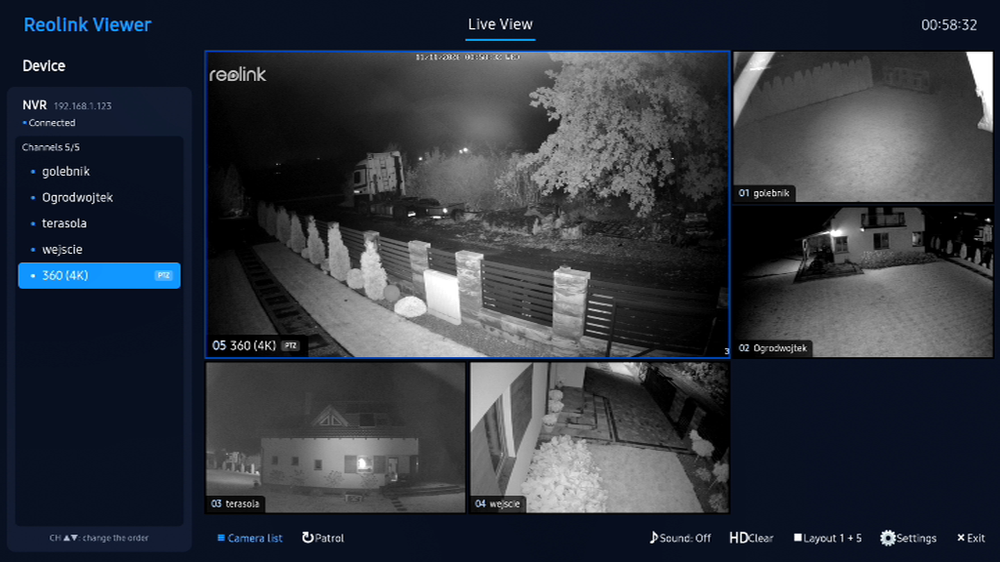
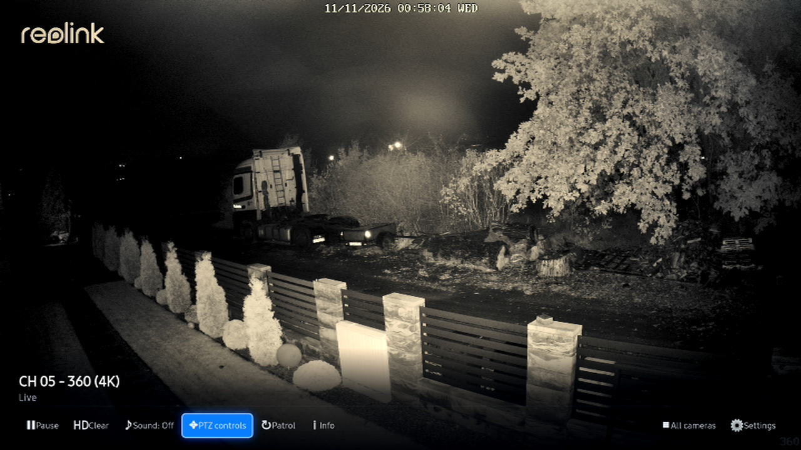
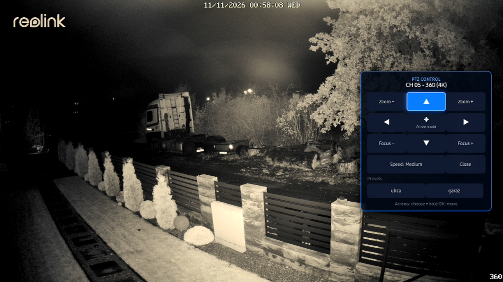
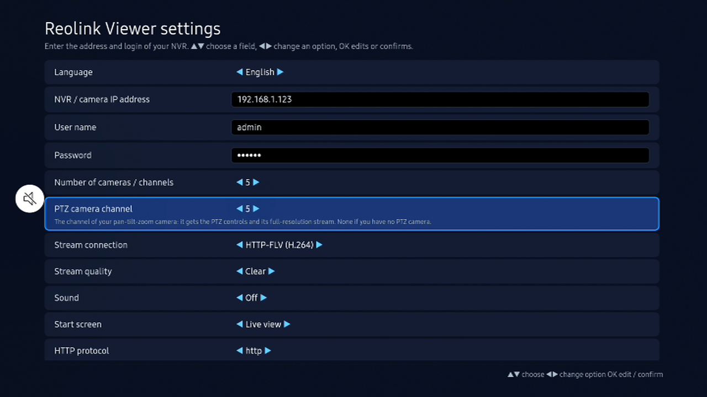

# Reolink2Samsung: Reolink viewer for Samsung Tizen TVs

A live viewer for Reolink NVRs and cameras that runs on a Samsung Smart TV (Tizen). All cameras on one screen,
any of them full screen, PTZ control, and everything reachable with just the arrow keys and OK on the TV remote.
It talks to the NVR on your local network only: no cloud, no account, no extra box.

Unofficial: this project is not made by, affiliated with or endorsed by Reolink.



| Full screen with the control bar | PTZ popup |
|---|---|
|  |  |



## Features

- **Live view** with a camera list, tiles and a toolbar. Layouts: 1 + 5 (one large tile), 2 × 2, 3 × 3, 4 × 2,
  with pages when there are more cameras than tiles. Tiles are snapshots refreshed in turn (the TV decodes one
  video stream at a time).
- **Full screen** live stream of any camera, with a control bar: pause, quality, sound, PTZ, patrol, info.
- **PTZ popup**: pan/tilt, zoom, focus, speed and the presets stored on the NVR. Hold OK to keep moving.
- **Patrol**: cycles through the cameras full screen every 10 seconds.
- **Quality** Fluent / Balanced / Clear (Reolink's sub / ext / main streams). If the TV cannot decode a quality
  for a camera, the app steps down by itself and remembers it.
- **Languages**: English (default), Polski, Español, Français, Italiano.
- Two ways to get the stream: HTTP-FLV straight from the NVR (default), or RTSP through a small relay service
  that ships inside the app.

## Remote control

Everything works with **▲ ▼ ◀ ▶ and OK**. The other keys are shortcuts.

| Where | Keys |
|---|---|
| Live view | Arrows move between the camera list, the tiles and the toolbar. **OK** on a small tile (layout 1 + 5) makes it the large one; **OK** on the large tile opens it full screen. |
| Camera list and tiles | **CH+ / CH−** move the focused camera earlier or later in the order; the list and the tiles follow. In layout 1 + 5 the large tile is the first place: **CH+** on the first small tile swaps it with the large one. |
| Full screen | **◀ ▶** previous / next camera. **OK** opens the control bar. **RETURN** goes back to the live view. |
| PTZ popup | Arrows choose a button, **OK** presses it (hold to keep moving). "Arrow mode" lets the arrows move the camera directly. |
| Settings | **▲ ▼** choose a row, **◀ ▶** change an option, **OK** edits a text field or confirms. |
| Shortcuts | Red: settings. Green: patrol. Blue or Play/Pause: PTZ (on the PTZ camera). CH+ / CH−: order (list and tiles), page (toolbar), camera (full screen). |

## Install

A ready-made package is in [`release/Reolink2Samsung.wgt`](release/Reolink2Samsung.wgt). It is signed with the public
Tizen SDK test certificate, which is meant for TVs in **Developer Mode**. If your TV refuses it, re-sign the
package with your own Samsung certificate (Tizen Studio's Certificate Manager).

1. On the TV open **Apps**, type `12345` on the remote, switch **Developer mode** on, enter your PC's IP address
   and restart the TV.
2. From a PC with the Tizen SDK tools:
   ```
   sdb connect <TV IP>
   tizen install -n Reolink2Samsung.wgt -t <TV name from "sdb devices">
   ```
   Any other sideloading tool for Tizen `.wgt` packages works too.

On first start the app opens **Settings**: enter the NVR's IP address, user name and password, the number of
channels, and (if you have one) which channel is the PTZ camera.

HTTP must be enabled in the NVR's network port settings: the TV does not accept the NVR's self-signed HTTPS
certificate.

## Build from source

The app is plain HTML, CSS and JavaScript in [`src/`](src). There is no build step: package the folder as a Tizen
web app and sign it.

```
tizen package -t wgt -s <your certificate profile> -- src
```

To pre-fill the settings for your own build, copy `default_config.example.json` to `src/default_config.json` and
edit it. That file is read once, on the first start, and is ignored by git so your password stays out of the repo.

| Path | What |
|---|---|
| `src/index.html`, `src/css/style.css` | The three screens: live view, player, settings |
| `src/js/app.js` | All app logic |
| `src/js/i18n.js` | Texts in the five languages |
| `src/js/vendor/mpegts.js` | [mpegts.js](https://github.com/xqq/mpegts.js) (Apache-2.0), plays the FLV / MPEG-TS streams |
| `src/service/relay.js` | RTSP to MPEG-TS / HLS relay that runs as a Tizen service on the TV |
| `src/config.xml` | Tizen manifest |

## Notes and limits

- Developed and tested on one TV: a Samsung QN85A (2021, Tizen 6.0) with a Reolink RLN8-410 NVR.
- On that TV the browser player cannot decode 2560 × 1920 H.264 main streams, so "Clear" falls back to
  "Balanced" for those cameras. A 4K H.265 main stream plays.
- The NVR password is stored in the app's local storage on the TV and is sent to the NVR in the request URL,
  as Reolink's HTTP API expects. Use it on a network you trust.

## Credits and licence

Based on [Apps2Samsung/ReolinkViewer](https://github.com/Apps2Samsung/ReolinkViewer) by Patrick Stel (MIT), which
provided the player engine and the RTSP relay. The live view, toolbar navigation, PTZ popup, translations and
quality fallback were added here.

MIT licence, see [LICENSE](LICENSE). "Reolink" is a trademark of its owner and is used here only to say what the
app works with.
